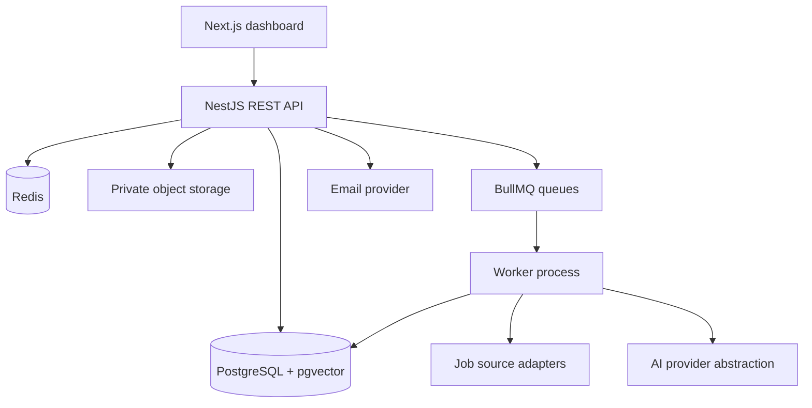
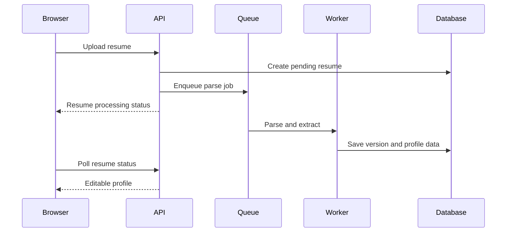

# JobPilot AI Architecture

## Current repository

- `apps/dashboard`: Next.js App Router dashboard shell.
- `apps/api`: NestJS API scaffold with a health placeholder route.
- `packages/*`: reserved package boundaries; no domain packages implemented yet.
- `infra/*`: reserved infrastructure configuration.

## Target topology



## Backend modules

`auth`, `users`, `profiles`, `resumes`, `jobs`, `job-sources`, `job-ingestion`, `job-matching`, `saved-jobs`, `applications`, `notifications`, `ai`, `audit`.

Each module owns controllers, DTOs, services, persistence interfaces, and tests. Controllers validate and authorize requests; services contain business rules; repositories isolate TypeORM queries.

## Runtime boundaries

- HTTP requests handle validation, authorization, reads, and small writes.
- Resume parsing, ingestion, embeddings, matching, and notifications run through BullMQ workers.
- Private documents are addressed by opaque IDs and short-lived signed URLs.
- The browser never receives provider secrets, database credentials, or raw private storage URLs.

## Initial package plan

```text
packages/
  ai/             provider abstraction, prompts, schemas
  database/       TypeORM data source, entities, migrations
  job-sources/    adapter contracts and source implementations
  matching/       hard filters and explainable scoring
  types/          shared API/domain types
  config/         validated environment configuration
  shared/         cross-app utilities
```

## API request flow


