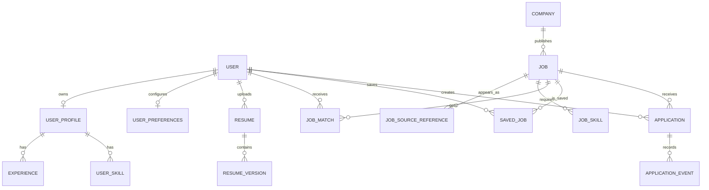

# JobPilot AI Database Design

PostgreSQL is the source of truth. TypeORM entities and migrations will live in `packages/database`. Use UUID primary keys, UTC timestamps, foreign keys, unique constraints, soft deletion only where recovery is useful, and tenant/user scoping on every private record.

## Core entities

## Tables

### Identity and profile

`users`, `user_profiles`, `user_preferences`, `experiences`, `educations`, `projects`, `certifications`, `skills`, `user_skills`.

### Resume intelligence

`resumes`, `resume_versions`, `resume_extractions`, `resume_embeddings`. Store extraction model/version and source version for reproducibility. Never overwrite the original document.

### Jobs

`companies`, `job_sources`, `jobs`, `job_skills`, `job_source_references`, `job_embeddings`, `job_ingestion_runs`.

`jobs` contains normalized fields plus `raw_source_data`, `status` (`ACTIVE`, `EXPIRED`, `REMOVED`, `UNKNOWN`), `last_seen_at`, `posted_at`, `apply_url`, and `source_url`.

### Matching and applications

`job_matches`, `saved_jobs`, `saved_searches`, `applications`, `application_events`, `application_documents`.

### Platform operations

`notifications`, `ai_conversations`, `ai_messages`, `ai_usage`, `audit_logs`, `subscriptions`.

## Important indexes

- `jobs(is_active, posted_at DESC)`
- `jobs(company_id, title_normalized, location_normalized)`
- `jobs(source_id, external_id)` unique
- `job_matches(user_id, score DESC)`
- `applications(user_id, status, updated_at DESC)`
- `saved_jobs(user_id, created_at DESC)` unique on `(user_id, job_id)`
- Full-text indexes for normalized title and description
- pgvector indexes for resume and job embeddings when volume justifies them

## Data rules

- Store source references instead of blindly merging duplicates.
- Keep raw source payloads for reprocessing with retention controls.
- Use optimistic concurrency for editable profile and application records.
- Add `created_at` and `updated_at` to all tables; add `deleted_at` to user-owned records that support recovery.
