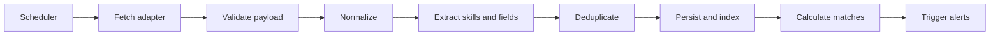

# Job Source Architecture

JobPilot uses authorized sources only. The priority order is official APIs, permitted employer career pages, licensed providers, and user-provided URLs. Unauthorized LinkedIn/Indeed scraping and login automation are explicitly out of scope.

## Adapter contract

```ts
interface JobSourceAdapter {
  readonly sourceName: string;
  fetchJobs(
    cursor?: string,
  ): Promise<{ jobs: ExternalJob[]; nextCursor?: string }>;
  fetchJobDetails?(externalId: string): Promise<ExternalJob>;
  supportsApplication(): boolean;
  apply?(
    externalId: string,
    payload: ApplicationPayload,
  ): Promise<ApplicationResult>;
}
```

## Initial adapters

- Greenhouse Job Board API, with application submission only when authorized and configured.
- Ashby public job postings API.
- Lever or SmartRecruiters where their documented API access is available.
- Employer career page adapter only after permission, robots/terms review, and structured-data validation.
- Licensed provider adapter behind the same interface.
- User URL import as an explicit, user-provided source.

## Current implementation

The API exposes `GET /jobs/live`. It calls configured Greenhouse and Ashby public job-board APIs using `GREENHOUSE_BOARDS` and `ASHBY_BOARDS` from the server environment, normalizes the response, extracts a first-pass skill set, and returns employer apply URLs. When no boards are configured, the UI uses clearly identified development fixtures so local onboarding remains demonstrable.

Google Search/Google Jobs does not provide a general public job-posting API for this product. Do not scrape Google, LinkedIn, or Indeed. Use authorized ATS feeds or a licensed provider instead.

## Ingestion flow



## Normalization

Each job must map to a common model containing source, external ID, company, title, description, location, remote type, employment type, experience, salary, posted/updated timestamps, application URLs, active status, verification status, last-seen timestamp, and raw source data.

## Deduplication and expiry

Use external ID, normalized company/title/location, description hash, and source references as signals. Do not blindly merge; preserve every source reference and prefer a verified employer apply URL. Mark jobs `UNKNOWN` before `EXPIRED` when a source misses multiple sync cycles.

## Operations

Every ingestion run records source, job ID, start/end time, counts, status, retries, and error details. Ingestion is a worker concern, never a long-running HTTP request.
